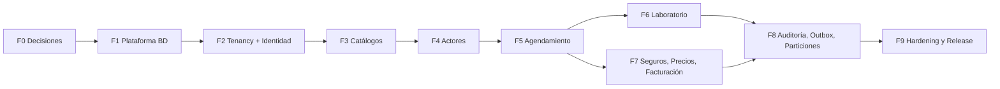

# Roadmap Data-First — Nexus (Agendamiento Clínicas y Laboratorios)

**Principio rector:** el esquema se construye **de los cimientos hacia arriba**. Ninguna fase se empieza si la anterior no cumple su *Definition of Done*. Así nunca se vuelve atrás: cada capa se apoya en algo ya probado.



> [!IMPORTANT]
> **Por qué se rehízo todo la vez anterior:** se modelaron 55 tablas antes de tener las reglas transversales (tenancy, IDs, auditoría, runner de migraciones). Este roadmap invierte el orden: **primero las reglas, luego las tablas**.

---

## Fase 0 — Decisiones y fundamentos (1–2 días, sin código)

**Objetivo:** cerrar las decisiones que, si cambian después, obligan a reescribir.

| # | Decisión | Recomendación |
|---|---|---|
| D1 | Versión de PostgreSQL | **18** (`uuidv7()` nativo). Si no: 16/17 + función propia |
| D2 | Estrategia de IDs | **UUIDv7** en todas las tablas expuestas por API; `bigint identity` solo en tablas hijas internas |
| D3 | Médico global o por clínica | **Global + `practitioner_roles` por tenant** (FHIR `PractitionerRole`) |
| D4 | Catálogo de servicios | **Híbrido:** `tenant_id NULL` = global, con valor = propio de la clínica |
| D5 | Slot | **1 slot = 1 cita** (grupal se difiere a una fase futura) |
| D6 | Facturación SRI | **Fuera del alcance inicial**; el modelo deja campos preparados |
| D7 | Runner de migraciones | **DbUp** (SQL puro, forward-only) |
| D8 | Aislamiento | **RLS** con `current_setting('app.tenant_id')` + `FORCE ROW LEVEL SECURITY` |
| D9 | Borrado | Soft delete (`deleted_at`) en datos clínicos; **sin `is_active` + `deleted_at` duplicados** |

**Entregables**
- ADRs en `brain/` (una nota atómica por decisión, con tags y enlaces `[[ ]]`, actualizando el MOC).
- Estructura del repo:
  ```
  src/Database/
    migrations/        V0001__extensions.sql, V0002__...
    seeds/             catálogos de referencia
    tests/             pruebas de BD
    conventions.md
  ```
- `docker-compose.yml` con PostgreSQL de la versión elegida.
- **Actualizar** [AGENTS.md](file:///Users/jeff/Documents/Agendamiento-clinicas-laboratorios/.agents/AGENTS.md) y la [regla E2E](file:///Users/jeff/Documents/Agendamiento-clinicas-laboratorios/.agents/rules/pruebas-manuales-end-to-end.md): la fuente de verdad pasa a ser `src/Database/migrations/*.sql`; el DBML se genera.

**Convenciones (fijar ahora)**
- `snake_case`, tablas en plural, esquema por dominio.
- Toda tabla de tenant: `tenant_id uuid NOT NULL`, `UNIQUE (tenant_id, id)`, políticas RLS y `tenant_id` como primera columna de sus índices.
- Toda FK entre tablas de tenant es **compuesta** `(tenant_id, x_id)`.
- Toda FK lleva índice.
- Enums como `CHECK` o tabla lookup, nunca `varchar` libre.
- Migraciones: inmutables una vez fusionadas; para corregir se crea una nueva.

**Hecho cuando:** las decisiones están escritas en `brain/` y nadie tiene dudas sobre D1–D9.

---

## Fase 1 — Plataforma de base de datos (2–3 días)

**Objetivo:** dejar listo todo lo transversal **antes** de la primera tabla de negocio.

**Migraciones**
- `V0001` extensiones: `pgcrypto`, `btree_gist`, `citext`.
- `V0002` schemas: `system`, `geographic`, `organization`, `practitioner`, `patient`, `scheduling`, `appointment`, `pricing`, `insurance`, `billing`, `audit`.
- `V0003` roles: `nexus_owner` (migraciones), `nexus_app` (DML, **no** es dueño de las tablas ni superusuario), `nexus_readonly`.
- `V0004` funciones reutilizables:
  - `uuidv7()` (si PG < 18)
  - `set_updated_at()` (trigger)
  - `current_tenant_id()` leyendo `app.tenant_id`
  - `audit_row_change()` (trigger genérico)
- `V0005` plantilla de RLS documentada y probada con una tabla de prueba.

**Backend**
- Proyecto `Nexus.Database.Migrator` (consola con DbUp).
- Interceptor de EF Core que ejecuta `SET LOCAL app.tenant_id = ...` al abrir cada transacción.
- Middleware que resuelve el tenant desde el JWT / header.

**Pruebas (Testcontainers + PostgreSQL real)**
- Un test que aplica todas las migraciones sobre una BD vacía.
- Un test que verifica que **sin `app.tenant_id` no se ve ninguna fila**.
- Un test que verifica que `nexus_app` no puede saltarse RLS.

**Hecho cuando:** `docker compose up` + `dotnet run` del migrator deja una BD vacía válida y los tests de RLS pasan en CI.

---

## Fase 2 — Tenancy e identidad (3–4 días)

**Tablas**
`organization_types`, `organizations`, `locations`, `location_addresses`, `location_contacts`, `users`, `roles`, `permissions`, `role_permissions`, `user_tenant_memberships`.

**Reglas a cuidar**
- `locations.tenant_id` es la única referencia al tenant (se elimina la duplicidad con `organization_id`).
- `tax_id` único **parcial** (`WHERE deleted_at IS NULL`).
- `email` único con `citext` y `WHERE deleted_at IS NULL`.
- Un usuario puede pertenecer a varias clínicas con roles distintos.
- Auditoría completa (`created_by/updated_by/deleted_by`) desde la primera tabla.

**Backend (TDD)**
- Alinear `Organization` con el esquema real (campos opcionales, auditoría, UUIDv7 generado por el dominio o la BD).
- Eliminar la migración EF `Initial`; EF pasa a ser **solo mapeo**.
- Autenticación (JWT / proveedor externo) + autorización basada en rol y tenant.

**Postman E2E:** crear organización → sede → usuario → asignar rol → login.

**Hecho cuando:** dos organizaciones de prueba no pueden ver datos de la otra ni por API ni por SQL directo.

---

## Fase 3 — Catálogos y datos maestros (2–3 días)

**Tablas**
`countries`, `states`, `cities`, `document_types`, `contact_types`, `specialty_categories`, `specialties`, `services`, `currencies`, estados y motivos (`appointment_statuses`, `cancellation_reasons`, `payment_*`, `refund_statuses`).

**Reglas**
- `services` incluye `service_type` (`CONSULTATION | LAB_TEST | IMAGING | PROCEDURE`), `attributes jsonb` (ayuno, muestra, preparación) y `tenant_id` nullable (híbrido, D4).
- Transiciones de estado en tabla `appointment_status_transitions`, no en JSON de texto.
- Seeds idempotentes (`INSERT … ON CONFLICT DO NOTHING`).

**Hecho cuando:** los catálogos se cargan con seeds y la API los expone en solo lectura con caché.

---

## Fase 4 — Actores: profesionales y pacientes (4–5 días)

**Tablas**
`practitioners` (global), `practitioner_roles` (por tenant: sede + especialidad), `practitioner_contacts`, `patients`, `patient_relations`, `patient_contacts`, `patient_addresses`, `patient_consents`.

**Reglas**
- Unicidad de documento **por tenant**: `(tenant_id, document_type_id, document_number) WHERE deleted_at IS NULL`.
- Si `document_number` se cifra, se añade `document_number_hash` (*blind index*) para búsquedas y unicidad.
- `patient_consents`: `consent_version`, `revoked_at`, `channel` (LOPDP).
- `CHECK (primary_patient_id <> dependent_patient_id)` en relaciones.
- Separar PII y PHI desde el diseño.

**Postman E2E:** registrar paciente → agregar dependiente → registrar consentimiento → crear profesional y rol en una sede.

**Hecho cuando:** un paciente se puede registrar, buscar y auditar con RLS probado, y un médico puede trabajar en dos clínicas sin duplicar su identidad.

---

## Fase 5 — Agendamiento (núcleo, 5–7 días)

> [!WARNING]
> Es la fase más delicada. Se hace con pruebas de concurrencia reales, no solo de dominio.

**Tablas**
`weekdays`, `practitioner_schedules`, `schedule_exceptions`, `slots`, `appointments`, `appointment_clinical_details`, `appointment_histories`, `telehealth_sessions`, `waitlists`, `rooms`, `equipments`.

**Reglas en la BD (no en el código)**
- `EXCLUDE USING gist` por profesional y por sala sobre `tstzrange(slot_start_at, slot_end_at)`, ignorando slots cancelados o expirados.
- `CHECK (slot_end_at > slot_start_at)`, `CHECK (end_time > start_time)`.
- Estado inicial del slot = `FREE`; ciclo `FREE → HELD → BOOKED`.
- `held_until` + job que libera reservas vencidas.
- `version` / `xmin` para concurrencia optimista; `SELECT … FOR UPDATE SKIP LOCKED` para tomar slots.
- Atomicidad: bloquear slot + crear cita + historial en **una** transacción.
- Eliminar duplicidad (`start_at`, `end_at`, `location_id` derivables del slot) o protegerla con `CHECK`/FK compuesta.
- Notas clínicas y notas de cancelación en `appointment_clinical_details`.

**Backend (TDD)**
- Máquina de estados de la cita en el dominio, con las transiciones validadas contra el catálogo.
- Comando `BookAppointment` con reintento ante conflicto de concurrencia.

**Pruebas obligatorias**
- 50 solicitudes simultáneas al mismo slot → **exactamente 1 éxito**.
- Intento de solapar horarios → rechazado por la BD.
- Slot retenido y vencido → liberado.

**Postman E2E:** generar agenda → buscar disponibilidad → reservar → confirmar → cancelar → reagendar.

**Hecho cuando:** es imposible el doble agendamiento aunque se salte la API y se inserte por SQL directo.

---

## Fase 6 — Laboratorio y órdenes (3–4 días)

**Alcance**
- `practitioner_id` pasa a ser **opcional** en slots y citas de tipo laboratorio.
- Tabla `service_requests` (orden de examen, FHIR `ServiceRequest`) y sus ítems.
- Agenda polimórfica por recurso (profesional, sala o equipo) con `resource_type` + `resource_id`.
- Instrucciones de preparación leídas desde `services.attributes`.

**Hecho cuando:** se agenda un examen de laboratorio sin médico y con instrucciones de ayuno.

---

## Fase 7 — Seguros, precios y facturación (5–6 días)

**Tablas**
`coverage_types`, `payers`, `plans`, `payer_provider_networks`, `patient_insurances`, `price_lists`, `service_prices`, `invoice_statuses`, `invoices`, `invoice_line_items`, `payments`, `refunds`.

**Reglas**
- Vigencias de precios sin solapamiento (`EXCLUDE` sobre `daterange`).
- Montos `>= 0` y `CHECK (total = subtotal + tax - discount)`.
- Una sola cobertura principal por paciente (índice único parcial).
- Numeración de documentos única **por tenant**.
- Facturas y pagos inmutables una vez emitidos (reversos con notas, no `UPDATE`).
- Campos del SRI preparados pero opcionales (D6).

**Hecho cuando:** una cita genera su cobro, un pago y un reembolso con estados consistentes y trazables.

---

## Fase 8 — Auditoría, eventos y escalabilidad (3–4 días)

- `audit.audit_logs` con **`tenant_id`**, particionado por mes (`PARTITION BY RANGE`) y PK que incluye la clave de partición.
- Triggers de auditoría activados en las tablas críticas (`patients`, `appointments`, `invoices`, `payments`).
- `outbox_messages` (transactional outbox) para notificaciones, recordatorios y correos.
- Job de creación y archivado de particiones (`DROP`, no `DELETE`).
- Vista materializada o proyección de **disponibilidad** para el buscador.
- Retención y política de purga de datos conforme a LOPDP.

**Hecho cuando:** cada cambio sensible queda registrado con usuario y tenant, y la búsqueda de disponibilidad no compite con las escrituras.

---

## Fase 9 — Hardening y salida a producción (3–5 días)

- Revisión de planes con `EXPLAIN (ANALYZE, BUFFERS)` para las consultas críticas.
- Auditoría de índices (faltantes e inutilizados) con `pg_stat_user_indexes`.
- Prueba de carga del flujo de reserva.
- Backups, PITR, y prueba real de restauración.
- Cifrado en reposo y TLS; secretos fuera del repositorio.
- CI/CD: migraciones en pipeline, validación de esquema, linter de SQL.
- Generación del DBML desde la BD y publicación en dbdiagramflow.
- Colección Postman completa con el roadmap E2E documentado (regla del proyecto).

---

## Definition of Done por tabla (checklist reutilizable)

- [ ] `tenant_id`, RLS habilitada y **forzada**, y política probada.
- [ ] PK UUIDv7 o identity; `UNIQUE (tenant_id, id)` si la referencian otras tablas.
- [ ] FKs compuestas con tenant; índice por cada FK.
- [ ] `CHECK` para enums, rangos y montos.
- [ ] `created_at/by`, `updated_at/by`; `deleted_at/by` si es dato clínico.
- [ ] Trigger `set_updated_at`; trigger de auditoría si aplica.
- [ ] Tipos correctos (`timestamptz`, `numeric`, `jsonb`, `citext`).
- [ ] Migración `.sql` + test en Testcontainers (positivo y negativo).
- [ ] Mapeo EF + entidad con XML docs bilingüe.
- [ ] Nota en `brain/`: diccionario de datos, changelog y MOC actualizados.
- [ ] Endpoint documentado y probado en Postman (campos tomados del esquema real, sin inventar).

---

## Estimación y riesgos

| Fase | Esfuerzo | Riesgo principal |
|---|---|---|
| F0 | 1–2 d | Decidir tarde y reescribir |
| F1 | 2–3 d | Roles/RLS mal configurados (el rol de la app como dueño anula RLS) |
| F2 | 3–4 d | Modelo de roles demasiado ambicioso |
| F3 | 2–3 d | Sobre-diseñar catálogos |
| F4 | 4–5 d | Cifrado vs. búsqueda/unicidad |
| F5 | 5–7 d | Concurrencia y ventanas de solapamiento |
| F6 | 3–4 d | Agenda polimórfica |
| F7 | 5–6 d | Alcance fiscal |
| F8 | 3–4 d | Particionado con PKs/FKs |
| F9 | 3–5 d | Falta de pruebas de carga |
| **Total** | **~31–43 días** | |

> [!TIP]
> Puedes publicar valor desde la **Fase 5**: con F1–F5 ya existe un MVP de agendamiento. F6–F8 se pueden reordenar según prioridad de negocio; F0–F5 **no**.
